<p align="center">
  
</p>

<h1 align="center">DoFu-Net: A Tri-Branch Fusion Network for LiDAR-Camera Place Recognition</h1>

<p align="center">
  CHONGQING UNIVERSITY · Key Laboratory of Optoelectronic Technology and Systems of Ministry of Education
</p>

<p align="center">
  <b>LiDAR-Camera Place Recognition · Panoramic Vision · Geometric Multi-View Interaction · Robust Sensor Fusion</b>
</p>

<p align="center">
  <a href="#-overview">Overview</a> ·
  <a href="#-method">Method</a> ·
  <a href="#-visualizations--demo">Demo</a> ·
  <a href="#-experimental-results">Results</a> ·
  <a href="#-installation--usage">Usage</a> ·
  <a href="#-citation">Citation</a>
</p>

<!-- TODO: Replace this file with the exported overview figure from the manuscript. -->
<p align="center">
  
</p>

**DoFu-Net** is a tri-branch LiDAR-camera place recognition framework that learns discriminative and robust **256-dimensional multimodal global descriptors** from LiDAR point clouds and panoramic multi-camera images. It integrates a geometry-guided LiDAR backbone, a panoramic visual continuity module, and lightweight cross-modal feature interactions.

> **Paper status:** Manuscript under revision for *ISPRS Journal of Photogrammetry and Remote Sensing*.
>
> **Repository status:** The nuScenes implementation and AV2S single-modality robustness scripts are available in this release. Full AV2S training, other dataset adapters, and trained checkpoints will be added separately.

---

## 🔍 Overview

DoFu-Net addresses three challenges in multimodal place recognition:

1. **LiDAR geometric organization:** learning complementary geometric structures across spherical views rather than treating each view independently.
2. **Panoramic visual continuity:** modeling local and cross-view feature relationships across concatenated surround-camera features.
3. **Robust multimodal fusion:** improving descriptor stability when one sensor modality becomes degraded.

The network contains three branches:

- **LiDAR Branch:** spherical **Pitch-Yaw (PY)**, **Radius-Yaw (RY)**, and **Radius-Pitch (RP)** representations, with geometry-guided axial interactions and progressive feature updates.
- **Visual Branch:** a shared-weight **ConvNeXtV2** encoder followed by the proposed **Local Continuity Graph (LCG)** module.
- **Fusion Branch:** low-rank multiplicative cross-modal interactions, contextual refinement, residual write-back, and a lightweight concatenation-based descriptor head.

---

## 🧠 Method

### 1. Geometry-Guided LiDAR Backbone

Building on the spherical three-view representation developed in our previous [Dome](https://github.com/ljkljk123/Dome-master) work, DoFu-Net introduces **learnable, progressive multi-view feature interaction** rather than reusing Dome's handcrafted descriptor-matching pipeline.

- **Pitch interaction:** associates the **PY and RP views** through their shared Pitch coordinate.
- **Yaw interaction:** associates the **PY and RY views** through their shared Yaw coordinate.
- **Axial Fusion Layer (AFL):** combines complementary view information through two geometry-guided attention paths.
- **Write Back Gate (WBG):** controls updates to the primary view, while FiLM-based feedback supports progressive auxiliary-view enhancement.

<!-- TODO: Export the AFL/WBG architecture or create its animation. -->
<p align="center">
  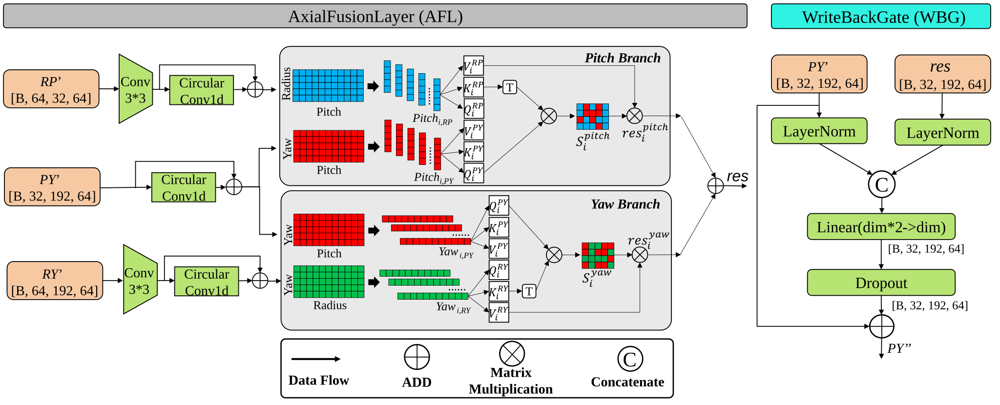
</p>

### 2. Panoramic Local Continuity Graph (LCG)

The proposed **LCG** module models adaptive local structural relationships in the panoramic feature map instead of relying exclusively on fixed neighborhood mixing. Its main operations include:

- Local differences between each feature node and its candidate neighbors.
- A learned spatially adaptive threshold and candidate-edge scoring.
- Discrete edge selection using an **STE-based hard binary gate**.
- Valid-neighbor-normalized message aggregation and feature updating.
- Horizontal circular neighborhood sampling for panoramic boundary continuity.

<!-- TODO: Replace with the LCG figure or graph-animation thumbnail. -->
<p align="center">
  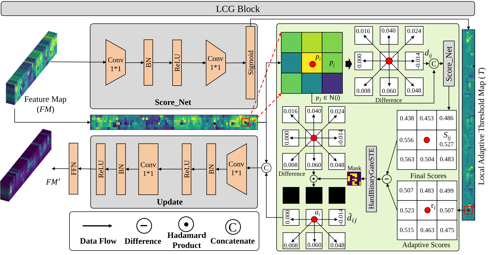
</p>

### 3. Lightweight LiDAR-Camera Fusion

The Fusion Branch performs **low-rank multiplicative feature interaction**, contextual refinement, and **residual write-back** into the unimodal branches. Separate LiDAR and visual global descriptors are then combined using a lightweight **concatenation + linear projection** head to produce a normalized 256-dimensional fused descriptor.

**Geometric alignment note:** Resizing LiDAR and panoramic visual features to a common feature-grid size does **not** imply point-to-pixel geometric alignment. DoFu-Net learns implicit feature associations between approximately directionally organized representations; its sensitivity to extrinsic perturbations is evaluated experimentally.

<!-- TODO: Export fusion-branch figure from the manuscript. -->
<p align="center">
  
</p>

---

## 🎬 Visualizations & Demo

### Place Recognition and SLAM Demonstration

<!-- TODO: Create a concise, muted preview GIF; link it to a complete video. -->
<p align="center">
  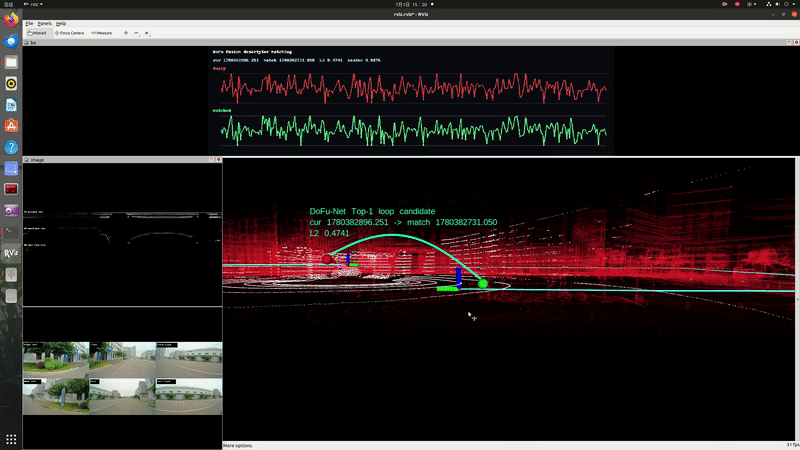
</p>

**Full SLAM demonstration:** [https://www.bilibili.com/video/BV1fbHg6UEpQ/?share_source=copy_web&vd_source=646c84d0e91d0a42c3b1130dc776744e]

### How the Modules Work

<!-- TODO: Optional animated illustrations with the same style and color palette. -->

- **AFL animation:** shared Pitch/Yaw coordinates → dual-path interactions → WBG update.
- **LCG animation:** local candidate neighbors → adaptive edge selection → message aggregation.
- **Robustness animation:** correct retrieval examples under LiDAR occlusion and visual degradation.

---

## 📊 Experimental Results

Experiments are conducted on **nuScenes**, **Argoverse 2 Sensor (AV2S)**, **NCLT**, and three self-collected sequences. The public-dataset results below use the paper's standard **9 m matching threshold**.

### Place Recognition Accuracy

| Dataset | Test sequence | DoFu-Net Recall@1 (%) | LCPR Recall@1 (%) |
|:--|:--|--:|--:|
| nuScenes | BS | **98.40** | 93.45 |
| nuScenes | SON | **99.52** | 98.46 |
| nuScenes | SHV | **99.23** | 86.12 |
| AV2S | DTW | **100.00** | 99.89 |
| AV2S | MIA | **97.24** | 94.14 |
| AV2S | PIT | **99.58** | 96.44 |
| NCLT | 2012-05-26 | **98.57** | 94.23 |
| NCLT | 2013-01-10 | **98.86** | 96.11 |
| NCLT | 2013-02-23 | **99.61** | 95.26 |

**Average Recall@1: 99.00%** across the nine public test sequences. Compared with LCPR, DoFu-Net achieves a **4.32% relative improvement** in average Recall@1 under the reported settings.

### Cross-Platform Generalization on Self-Collected Sequences

The following animations visualize the **top-1 place recognition results on Seq02** of our self-collected dataset. The first row shows five LiDAR-camera methods, and the second row shows four single-modality baselines. **Green:** correct matches; **red:** incorrect matches; **blue:** missed loop detections. Click an animation to view it at full size.

<!-- GIF directory: assets/gifs/<Algorithm>/seq02_matches3d.gif -->
<table align="center">
  <tr>
    <td align="center">
      <a href="assets/gifs/DoFu/seq02_matches3d.gif">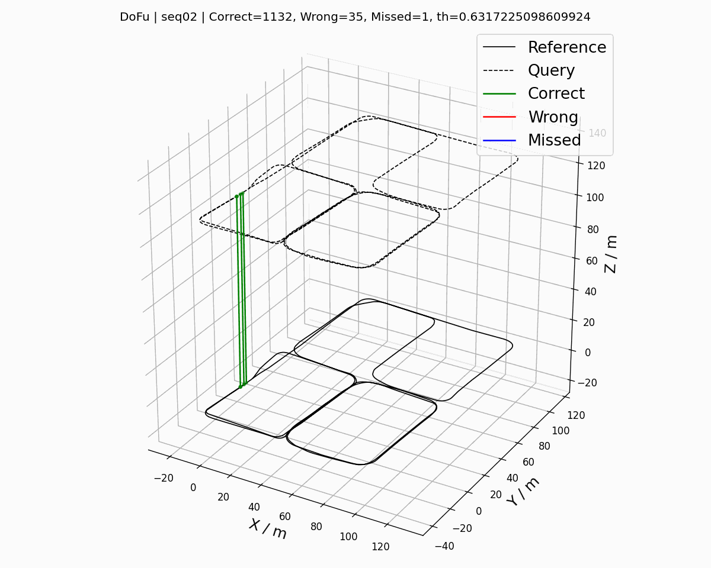</a>
      <br/><strong>DoFu-Net</strong>
    </td>
    <td align="center">
      <a href="assets/gifs/LCPR/seq02_matches3d.gif">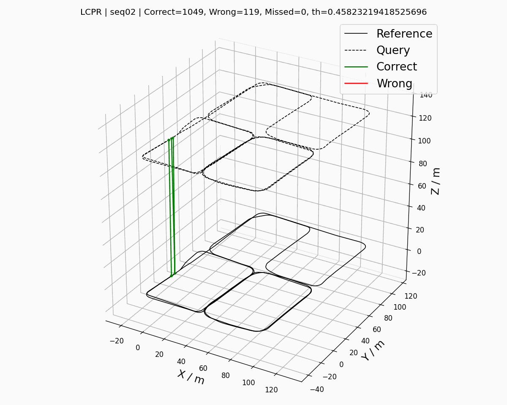</a>
      <br/><strong>LCPR</strong>
    </td>
    <td align="center">
      <a href="assets/gifs/AdaFusion/seq02_matches3d.gif">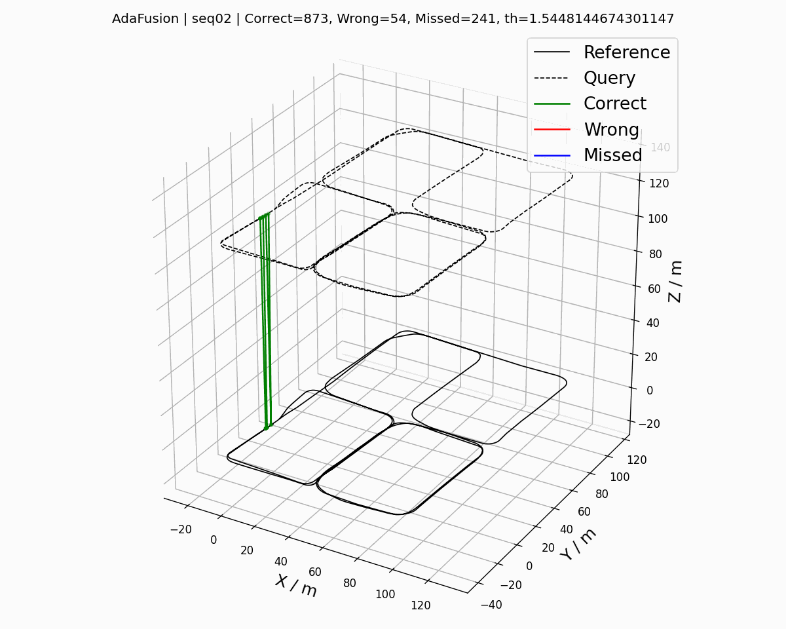</a>
      <br/><strong>AdaFusion</strong>
    </td>
    <td align="center">
      <a href="assets/gifs/MinkLoc++/seq02_matches3d.gif">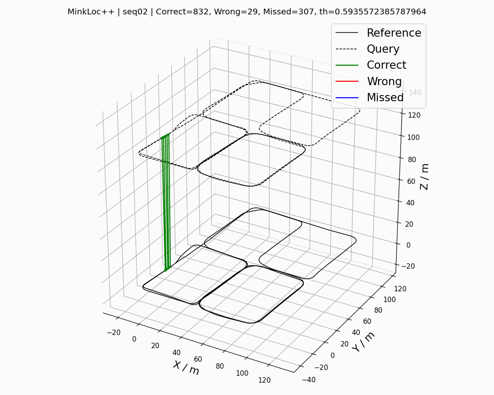</a>
      <br/><strong>MinkLoc++</strong>
    </td>
    <td align="center">
      <a href="assets/gifs/UMF/seq02_matches3d.gif">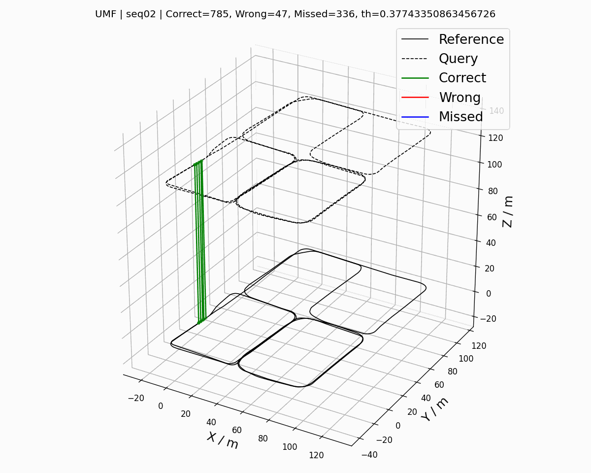</a>
      <br/><strong>UMF</strong>
    </td>
  </tr>
</table>

<table align="center">
  <tr>
    <td align="center">
      <a href="assets/gifs/BoQ/seq02_matches3d.gif">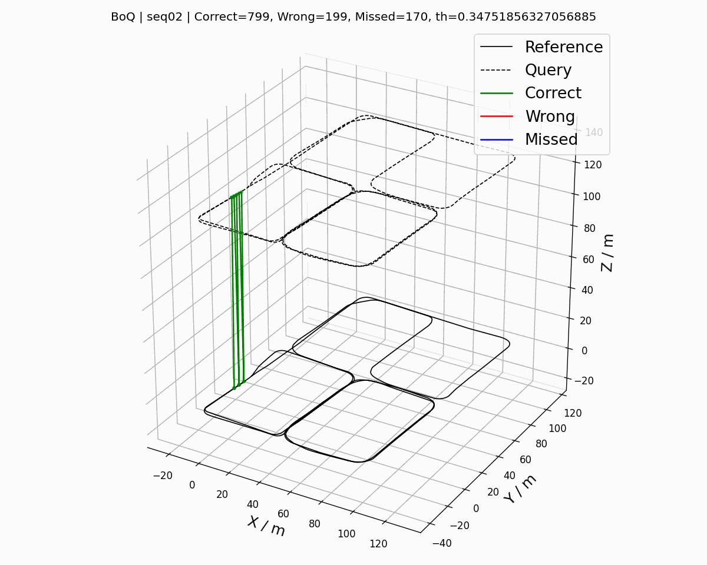</a>
      <br/><strong>BoQ</strong>
    </td>
    <td align="center">
      <a href="assets/gifs/SelaVPR/seq02_matches3d.gif">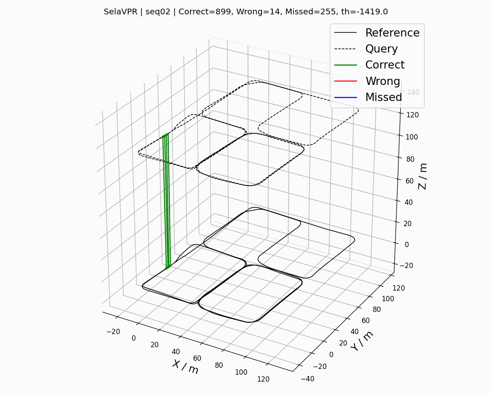</a>
      <br/><strong>SelaVPR</strong>
    </td>
    <td align="center">
      <a href="assets/gifs/OverlapMamba/seq02_matches3d.gif">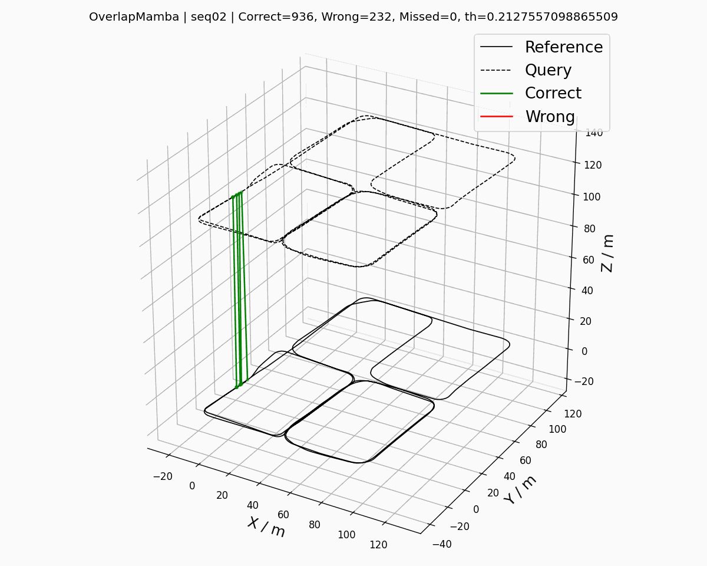</a>
      <br/><strong>OverlapMamba</strong>
    </td>
    <td align="center">
      <a href="assets/gifs/RangePlace/seq02_matches3d.gif">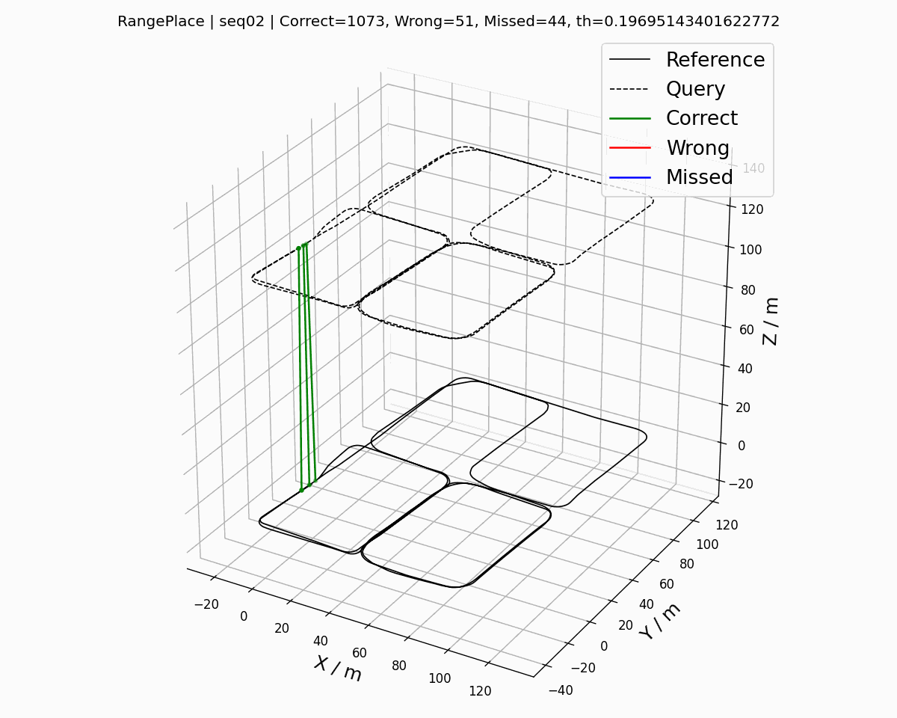</a>
      <br/><strong>RangePlace</strong>
    </td>
  </tr>
</table>

---

## 🗂️ Datasets

| Dataset | Sensors used | Role |
|:--|:--|:--|
| nuScenes | Top LiDAR + six surround-view cameras | Training / validation / testing; cross-region testing |
| AV2S | LiDAR + seven surround-view cameras | Training / validation / testing |
| NCLT | Velodyne LiDAR + six cameras | Cross-date training / validation / testing |
| Self-collected | 16-beam LiDAR + six cameras | Cross-platform evaluation only |

Datasets must be obtained independently from their respective providers. Please follow the original providers' licenses and usage terms.

For nuScenes metadata generation, database/query splits, and LiDAR three-view preprocessing, see [Dataset Preparation (nuScenes)](#dataset-preparation-nuscenes) below.

---

## 📦 Installation & Usage

This repository contains the **nuScenes training/evaluation implementation** of DoFu-Net, together with the **AV2S visual-degradation and LiDAR-occlusion robustness reproduction tools**. nuScenes code covers spherical three-view preprocessing, multi-camera loading, training, feature extraction, and place-recognition evaluation on BS, SON, and SHV. The AV2S components supplied here cover the **two robustness experiments only**, not the complete AV2S training or general benchmarking pipeline; NCLT and self-collected dataset adapters are not included. No dataset or trained DoFu-Net checkpoint is bundled.

### Environment

The reported environment was exported from the authors' Conda installation; the OS release was not recorded in the export.

- **OS:** Linux (distribution/version not available in the environment export)
- **Python:** 3.10.13
- **PyTorch / TorchVision:** 2.1.1+cu118 / 0.16.1+cu118
- **CUDA:** PyTorch CUDA 11.8 build
- **FAISS:** faiss-gpu 1.8.0
- **Key packages:** timm 0.9.2, NumPy 1.26.2, SciPy 1.11.4, scikit-learn 1.3.2, h5py 3.7.0, nuscenes-devkit 1.1.10, OpenCV 4.8.1.78, safetensors 0.4.1
- **Training GPU reported in the paper:** NVIDIA RTX 4060

The following commands are a portable *installation starting point* based on the exported versions; installation on a new machine has not yet been verified end to end. A compatible NVIDIA GPU driver is required for CUDA acceleration.

```bash
conda create -n dofunet python=3.10.13 -y
conda activate dofunet

# PyTorch CUDA 11.8 wheels (the author's original PyTorch build).
python -m pip install torch==2.1.1 torchvision==0.16.1 torchaudio==2.1.1 \
  --index-url https://download.pytorch.org/whl/cu118

# FAISS GPU availability can depend on your Linux architecture and channels.
conda install -c pytorch -c conda-forge faiss-gpu=1.8.0

# Remaining Python packages from the exported environment.
python -m pip install -r requirements.txt
```

### Repository Setup

Clone this repository after publishing it to GitHub, then run all following commands from its root directory:

```bash
# Replace <YOUR_GITHUB_REPOSITORY_URL> with the published DoFu-Net repository URL.
git clone <YOUR_GITHUB_REPOSITORY_URL> DoFu-Net-nuScenes
cd DoFu-Net-nuScenes

# Verify the installed packages and project imports.
python -m scripts.verify_imports
```

The code is organized as follows:

```text
DoFu-Net-nuScenes/
├── config/config.yaml              # Paths and training hyperparameters
├── dataset/NuScenesDataset.py      # LiDAR and six-camera data loaders
├── dataset/AV2Dataset.py           # AV2S seven-camera + LiDAR robustness adapter
├── config/config_av2.yaml          # AV2S robustness configuration (edit paths)
├── modules/DoFuNet.py              # DoFu-Net architecture
├── modules/netvlad.py              # NetVLAD descriptor head
├── tools/gen_info.py               # nuScenes metadata extraction
├── tools/gen_index.py              # Database/query index generation
├── tools/gen_range.py              # PY/RY/RP three-view generation
├── tools/gen_range_av2.py          # AV2S projection and point-cloud reading helpers
├── tools/utils_av2.py              # AV2S camera order and path/configuration helpers
├── robustness/
│   ├── visual/
│   │   ├── gen_av2_query_visual_perturb_mid_final_hddopt.py
│   │   └── test_av2_camera_visual_robustness_offline_midonly_fast.py
│   └── lidar/
│       ├── gen_range_av2_lidar_occ_query.py
│       └── test_av2_lidar_occ.py
├── tools/runner.py                 # Training and evaluation utilities
├── tools/utils.py                  # Shared configuration/path helpers
├── train.py                        # Training entry point
├── test.py                         # Test/evaluation entry point
└── requirements.txt                # Core Python package versions
```

### Dataset Preparation (nuScenes)

Download nuScenes **v1.0-trainval** and **v1.0-test**, including their sensor samples and metadata, according to the dataset license. Place both versions under the nuScenes root directory expected by the devkit.

Choose your local dataset root using the environment variable **NUSCENES_ROOT**, or edit **data.data_root_dir** in **config/config.yaml**.

```bash
export NUSCENES_ROOT=/path/to/nuscenes

# 1. Generate metadata files (BS, SON, SHV, SQ).
python -m tools.gen_info

# 2. Generate database/query split files.
python -m tools.gen_index

# 3. Generate three-view LiDAR .npz files.
python -m tools.gen_range
```

After preprocessing, the relevant files should be arranged as follows:

```text
/path/to/nuscenes/
├── samples/
│   ├── CAM_FRONT/...              # Original nuScenes images
│   ├── LIDAR_TOP/...              # Original nuScenes point clouds
│   └── RANGE_DOFU_3VIEW/
│       └── <LiDAR sample name>.npz
├── nuscenes_infos-bs.pkl
├── nuscenes_infos-son.pkl
├── nuscenes_infos-shv.pkl
├── nuscenes_infos-sq.pkl
├── bs_db.npy
├── bs_train_query.npy
├── bs_val_query.npy
├── bs_test_query.npy
├── son_db.npy
├── son_query.npy
├── shv_db.npy
├── shv_query.npy
└── ...
```

Each generated LiDAR **.npz** contains **py**, **ry**, **rp**, **pitch_min**, and **pitch_max**. The three view sizes generated by this code are **PY: 32×768**, **RY: 64×768**, and **RP: 64×32**. The loader pads these to a common **3×64×768** tensor without changing the underlying three-view data.

**If you already generated these files using the older experimental code, you do not need to recompute them.** Set **data.lidar_view_dir** in **config/config.yaml** to your *existing* folder relative to the nuScenes root. It may use a different name; no directory rename is necessary. This setting is shared by training, evaluation, and preprocessing.

### Training

The original nuScenes configuration is retained: six surrounding cameras, image resize **192×512**, four triplet negatives, margin **0.5**, initial learning rate **1e-5**, StepLR step **6** / gamma **0.5**, and **120 epochs**. The feature cache is refreshed every **3 epochs** and also initialized before the first training epoch when missing.

The visual branch is initialized using a local ConvNeXtV2-Atto **.safetensors** checkpoint. Place that checkpoint in the path specified by **runner.convnextv2_ckpt_path** in **config/config.yaml**, or point the field to its actual absolute path. The example path is a placeholder; the pretrained file is **not** included.

```bash
export NUSCENES_ROOT=/path/to/nuscenes
# Edit runner.convnextv2_ckpt_path in config/config.yaml first.
python train.py --config config/config.yaml
```

Training checkpoints are saved under **runs/checkpoints/** as **DoFuNet_epoch_&lt;N&gt;.pth.tar**, e.g. **DoFuNet_epoch_120.pth.tar**; validation and cache files are stored in their respective **runs/** subdirectories. To resume, set **runner.resume_path** in the YAML to your checkpoint. If you switch to a different experiment/checkpoint, remove any stale cached features before training.

**Checkpoint compatibility:** the original neural layers and their **state_dict** parameter names are preserved; only the *outer class name* and file names have changed. Existing checkpoints containing a **net** state dictionary can still be selected by path. The original checkpoint filename itself does not need to be renamed.

### Evaluation

Provide a **trained fused DoFu-Net** checkpoint explicitly. Do not substitute a visual-only ablation checkpoint or the ConvNeXtV2 backbone initialization weights. By default, the script evaluates BS, SON, and SHV; SQ is optional.

```bash
export NUSCENES_ROOT=/path/to/nuscenes
python test.py \
  --config config/config.yaml \
  --checkpoint runs/checkpoints/DoFuNet_epoch_120.pth.tar \
  --splits BS SON SHV

# Optional: test just one region, or include SQ if its query files exist.
python test.py --checkpoint /path/to/your/trained_dofunet.pth.tar --splits SHV
```

The evaluator extracts **256-D** global descriptors, retrieves candidates using FAISS L2 search, and reports Recall@1/5/10/20, precision-recall curves, ROC curves, and maximum F1. Outputs are written under **runs/results/&lt;SPLIT&gt;/** with a combined **runs/results/nuscenes_summary.csv**. The matching radius used by the supplied code is **9 m**.

### AV2S Robustness Experiments (Visual Degradation and LiDAR Occlusion)

The release also contains the **four scripts used for the AV2S robustness workflow**: two offline perturbation generators and two matching/evaluation programs. The AV2S evaluation uses the **DTW, MIA, and PIT** test sets, seven Ring cameras (in the fixed order in **tools/utils_av2.py**), and 256-D descriptors. **Only query observations are degraded; database observations, ground-truth relationships, and model weights remain unchanged.** Recall@1/5/10/20, maximum F1, PR-curve samples, retrieval lists, and descriptor caches are exported. These experiments require **separately trained DoFu_Camera and DoFu_LiDAR checkpoints**, not the nuScenes fused checkpoint used above.

#### AV2S prerequisites and file locations

Edit [**config/config_av2.yaml**](config/config_av2.yaml) to set the real paths for **data.data_root_dir** (original AV2S image/point-cloud root), **data.database_path** (e.g. **/path/to/AV2S/av2_db.npy**, used to locate the index directory), **data.test_info_path** (**av2_infos_test.pkl**), **data.range_data_dir** (the **existing clean** three-view **.npz** directory), and **runner.eval_weights**. The **config_av2.yaml** defaults include illustrative **/path/to/...** placeholders and **must be edited**. If your existing clean three-view folder still has a legacy name, simply point **data.range_data_dir** to it; no renaming or regeneration is required.

The AV2S index directory (the parent directory of **data.database_path**) must already contain **av2_test_dtw_db.npy**, **av2_test_dtw_query.npy**, and corresponding **mia** and **pit** pairs, plus the **av2_infos_test.pkl** referenced in your configuration. Index arrays identify frames in that metadata file and contain XY locations in columns 1 and 2; they are **not generated by the four robustness scripts**. Raw AV2S LiDAR **.feather** files require **pandas and pyarrow**, and input camera images are read using the seven channel names recorded in the metadata. The provided dataset adapter loads **.npz** views **py (32×768)**, **ry (64×768)**, **rp (64×32)** and pads them exactly as the original architecture requires to ****[3, 64, 768]****. Set **num_cam: 7** and **resize: [160, 448]** as in the supplied AV2S configuration. The reference matching radius is **9 m**.

For reproducible results, evaluate **visual-only** and **LiDAR-only** checkpoints trained with the same **DoFuNet** architecture and compatible **state_dict** keys. You can select them separately with each evaluator's **--weights** argument; both tests load model parameters with normal strict **load_state_dict**. The helper wrappers in this release extract the *independent branch outputs* through **visual_branch(...)** and the **pre_fusion → lidar_vc_neck → lidar_netvlad** path, respectively. The multimodal fusion output is not used in these two tests.

#### Visual perturbations: all 29 fixed MID-severity parameters

The visual generator applies **one of four fixed perturbation configurations** to each *test query camera image*; clean database images are left intact. These are synthetic image transformations, not physically calibrated weather simulators. Values below are taken directly from the shipped **PERTURB_CFG_MID** dictionary in [**gen_av2_query_visual_perturb_mid_final_hddopt.py**](robustness/visual/gen_av2_query_visual_perturb_mid_final_hddopt.py). RGB intensities are normalized to **[0, 1]** inside the generator unless otherwise stated. A parameter named **blur_sigma** is an OpenCV Gaussian-blur standard deviation in pixels.

**Exposure (3 parameters):** increases image brightness through a nonlinear RGB adjustment and an HSV value-channel offset.

| Parameter | Value | Meaning |
|:--|--:|:--|
| **gain** | **1.28** | Multiplicative gain applied to gamma-adjusted RGB intensities; values are clipped to [0, 1] |
| **gamma** | **0.965** | Power-law exponent applied to the normalized RGB image before gain; a value below 1 brightens midtones |
| **v_lift** | **0.035** | Additive brightness offset applied to the HSV V channel, scaled by 255 in the 8-bit implementation |

**Lowlight (4 parameters):** darkens the image, then adds low-amplitude sensor-like noise and blur.

| Parameter | Value | Meaning |
|:--|--:|:--|
| **brightness_scale** | **0.82** | Multiplier reducing gamma-adjusted brightness |
| **gamma** | **1.08** | Power-law exponent greater than 1 that further darkens midtones |
| **noise_sigma** | **0.002** | Standard deviation of additive zero-mean Gaussian RGB noise on normalized [0, 1] intensities |
| **blur_sigma** | **0.15** | Gaussian blur standard deviation for subtle low-light softness (pixels) |

**Rain (16 parameters):** synthesizes sparse slanted rain streaks, filters a rain layer, blends it into the image, then adjusts visibility and appearance.

| Parameter | Value | Meaning |
|:--|:--|:--|
| **density** | **0.00045** | Rain-streak count proportional to image area: **int(height × width × density)** |
| **min_count** | **220** | Minimum number of rain streaks per image, overriding a smaller area-derived count |
| **angle_deg** | **-13.0** | Rain-streak orientation in degrees, used to calculate endpoint displacement |
| **base_len** | **16** | Base stroke length in pixels |
| **len_jitter** | **4** | Integer random variation around base length, from −4 to +4 pixels |
| **ksize** | **17** | Side length of the diagonal motion-filter kernel applied to the streak layer (pixels) |
| **layer_blur** | **0.55** | Gaussian blur sigma applied to the rain layer (pixels) |
| **val_range** | **(0.76, 1.00)** | Uniform range of initial rain-streak brightness values on [0, 1] |
| **thick_prob2** | **0.18** | Probability of drawing a rain streak two pixels thick rather than one |
| **darkening** | **0.94** | Multiplicative darkening of the blended rainy image |
| **rain_alpha** | **0.16** | Mixing weight assigned to the synthesized rain layer |
| **veil_value** | **0.79** | Normalized gray brightness used for a uniform atmospheric veil |
| **veil_alpha** | **0.08** | Mixing weight assigned to the veil |
| **saturation_scale** | **0.95** | Multiplier for HSV saturation after rain/veil blending |
| **contrast_scale** | **0.95** | Contrast reduction around normalized mid-gray 0.5 |
| **blur_sigma** | **0.40** | Final Gaussian blur standard deviation (pixels) |

**Smoke (6 parameters):** simulates spatially varying transmissivity using a smooth random field and blends the scene with a gray smoke color.

| Parameter | Value | Meaning |
|:--|:--|:--|
| **trans_hi** | **0.90** | Upper baseline transmittance used in **trans = trans_hi − trans_delta × noise** |
| **trans_delta** | **0.18** | Amplitude of spatial transmittance reduction under the smoothed random field |
| **trans_clip** | **(0.68, 0.90)** | Minimum/maximum transmittance after clipping; lower transmittance means denser smoke |
| **smoke_gray** | **0.80** | Normalized gray intensity blended into the image as scattered/obscuring smoke light |
| **contrast_scale** | **0.90** | Final contrast reduction about normalized intensity 0.5 |
| **noise_base** | **28** | Divisor determining the coarse random-field grid before upsampling (**H//28**, **W//28**, each at least 6) |

**Reproducibility notes.** Exposure is deterministic. Lowlight, rain, and smoke use a **stable SHA-1-derived per-image seed** based on the relative camera image path and condition name. The generator writes its exact parameter dictionary to **perturb_configs/perturb_parameters.txt** and a per-image manifest to **perturb_configs/perturb_manifest.csv**. It uses **num_workers=4** and **chunksize=8** by default for mechanical-HDD-friendly processing, and skips existing outputs unless **--overwrite** is specified. The same generated image files may be reused across different visual methods for fair comparisons.

#### Visual: generate degraded query images

From the **repository root**:

```bash
python -m robustness.visual.gen_av2_query_visual_perturb_mid_final_hddopt \
  --config config/config_av2.yaml \
  --out_root /path/to/AV2S_QUERY_PERTURB_MID \
  --city_tags DTW,MIA,PIT \
  --num_workers 4 \
  --chunksize 8
```

The output follows the original relative camera-image paths under four condition folders:

```text
/path/to/AV2S_QUERY_PERTURB_MID/
├── exposure/<original_relative_camera_image_path>
├── lowlight/<original_relative_camera_image_path>
├── rain/<original_relative_camera_image_path>
├── smoke/<original_relative_camera_image_path>
└── perturb_configs/
    ├── perturb_manifest.csv
    └── perturb_parameters.txt
```

#### Visual: evaluate the DoFu_Camera descriptor

Use the **visual-only DoFu_Camera checkpoint** (not the fused DoFu-Net checkpoint). The evaluation script reads all four already-generated conditions for each query together for faster shared loading, processes them in configurable chunks, and reuses the clean database features:

```bash
python -m robustness.visual.test_av2_camera_visual_robustness_offline_midonly_fast \
  --config config/config_av2.yaml \
  --weights /path/to/DoFu_Camera.pth.tar \
  --perturb_root /path/to/AV2S_QUERY_PERTURB_MID \
  --result_dir runs/results_av2 \
  --city_tags DTW,MIA,PIT \
  --batch_size_clean 16 \
  --batch_size_query 4 \
  --condition_chunk 4
```

If GPU memory is insufficient, try **--batch_size_query 2** and/or **--condition_chunk 2**. The script writes its summary to **runs/results_av2/camera_visual_robustness_offline_midonly_fast/robustness_summary_camera.csv** and detailed per-city/per-condition features, PR-curve CSV files, and **query_topk.csv**. By default, it **uses CUDA automatic mixed precision when a GPU is available**, as in the original provided evaluator; this behavior is retained to avoid silently changing the supplied evaluation implementation.

#### LiDAR occlusion protocol

The LiDAR generator removes points inside a **single random horizontal Yaw sector** of width **30°, 60°, 90°, or 120°** in each *test query frame*, using the same randomly selected center angle for that frame across all four widths. Raw points within 2 m are removed *before* the simulated occlusion. The surviving points are **reprojected from 3D**, not deleted from the already constructed images. Each **.npz** stores new PY (32×768), RY (64×768), and RP (64×32) views, with **max_radius=80.0 m** and per-frame **pitch_mode=minmax**, matching the supplied generating code. **Database inputs remain clean**. The generator's default random seed is **2026**, and the exact center angle is saved in a CSV file; additional seeds can be evaluated by changing **--seed** in both commands. The width specifies a removed *angular sector*, **not a fixed percentage of points**.

#### LiDAR: generate occluded query three-view files

```bash
python -m robustness.lidar.gen_range_av2_lidar_occ_query \
  --config config/config_av2.yaml \
  --out_root /path/to/AV2S/RANGE_DOME3VIEW_OCC \
  --city_tags DTW,MIA,PIT \
  --occ_degrees 30 60 90 120 \
  --seed 2026 \
  --proj_H 32 --proj_W 768 --proj_R 64 --max_radius 80
```

The output directories are **occ_030_seed2026/**, **occ_060_seed2026/**, **occ_090_seed2026/**, and **occ_120_seed2026/** under the specified root. Reproducibility manifests are saved under **occ_configs/**, including **fixed_query_yaw_centers_seed2026.csv**. The generator reads raw AV2S **.feather** or **.bin** LiDAR files through **tools/gen_range_av2.py**.

#### LiDAR: evaluate the DoFu_LiDAR descriptor

Use the **LiDAR-only DoFu_LiDAR checkpoint** and the **same** occlusion root and random seed used during generation:

```bash
python -m robustness.lidar.test_av2_lidar_occ \
  --config config/config_av2.yaml \
  --weights /path/to/DoFu_LiDAR.pth.tar \
  --occ_root /path/to/AV2S/RANGE_DOME3VIEW_OCC \
  --result_dir runs/results_av2 \
  --city_tags DTW,MIA,PIT \
  --occ_degrees 30 60 90 120 \
  --seed 2026 \
  --batch_size 1
```

The evaluator extracts a clean database feature set once per city and reuses it for all occlusion degrees, recomputing only the occluded query descriptors. Summary CSV: **runs/results_av2/lidar_occ_robustness/robustness_summary_lidar.csv**; per-condition directories also include PR-curve samples, Top-K matches, and saved feature matrices. Both evaluators support **--force_recompute** to invalidate previous feature caches when using different checkpoints or changed inputs. Without this flag, existing feature caches may be loaded regardless of whether the **--weights** argument has changed, so **never reuse stale cached descriptors when changing checkpoints**.

**Scope of this AV2S addition:** The code above reproduces the two **single-modality** robustness protocols only. It does not provide the full AV2S train/validation split construction, AV2S full-model training, other-method baselines, fusion-head comparison experiment, or cross-modal degradation experiment. Their absence does not affect the nuScenes implementation in this repository.

---

## 📄 Citation

If you find DoFu-Net useful, please cite the paper:

**DoFu-Net: A Tri-Branch Fusion Network for LiDAR-Camera Place Recognition**

*Manuscript under revision for ISPRS Journal of Photogrammetry and Remote Sensing.*

The official BibTeX entry will be added when the final bibliographic information is available.

### Related Work

The spherical three-view representation builds upon our earlier work:

- [Dome: Fast and Robust LiDAR Place Recognition via Spherical Three-View Feature Fusion](https://github.com/ljkljk123/Dome-master), *Measurement*, 2026.

---

## 📌 License & Contact

- **License:** [To be selected and added as a **LICENSE** file.]
- **Academic inquiries / commercial use:** [Add the appropriate contact and usage conditions.]

<!-- TODO before publishing: replace all pending links and image placeholders; verify setup commands; ensure claimed released assets actually exist. -->
